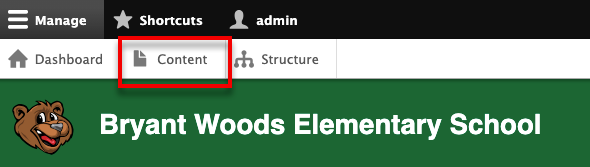
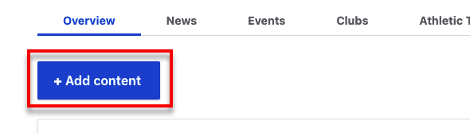
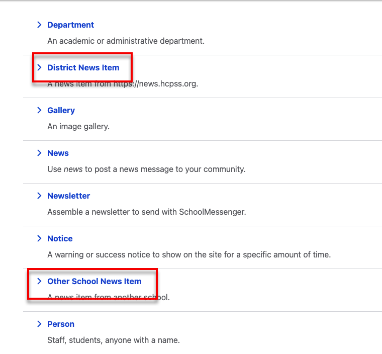
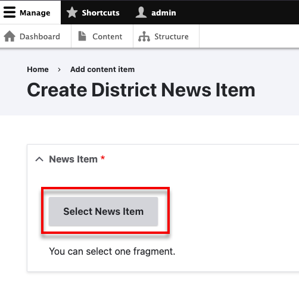
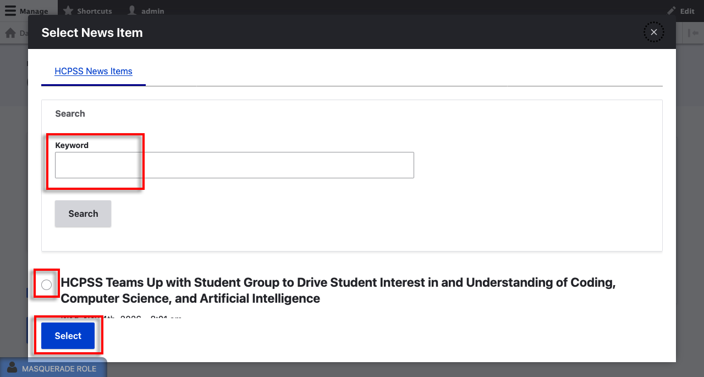
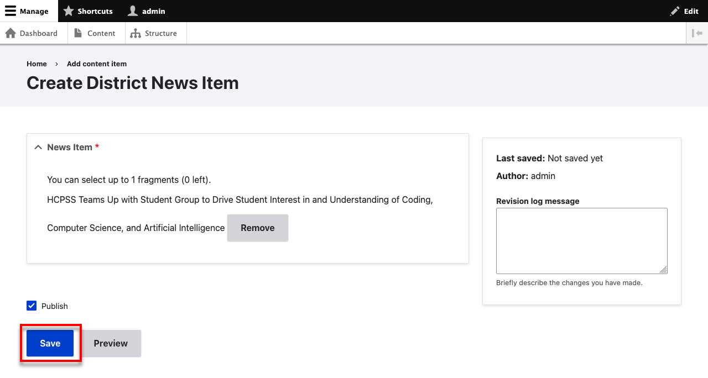
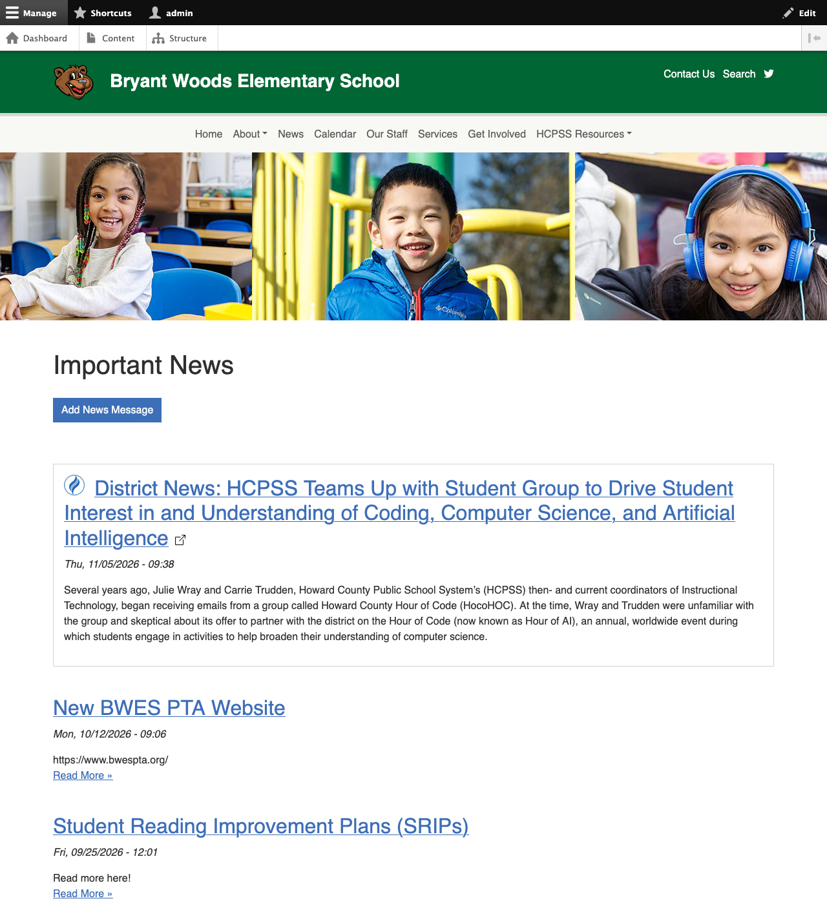
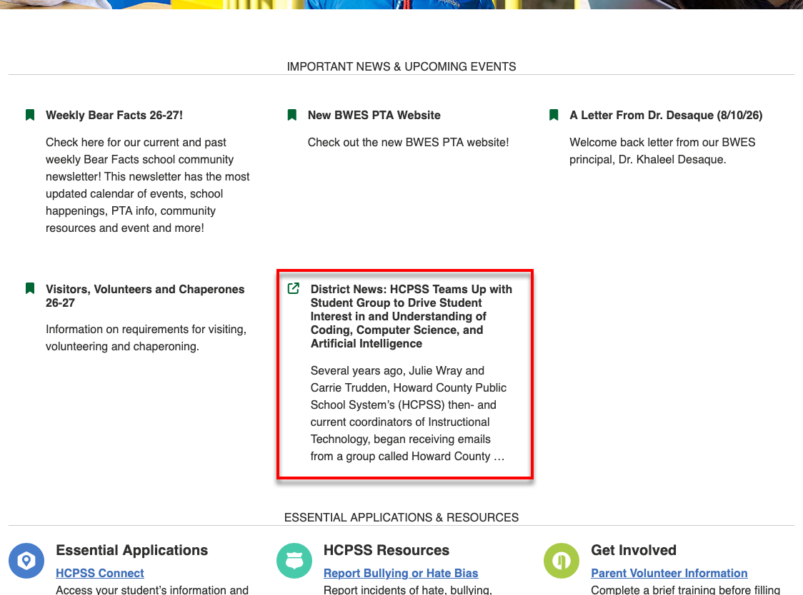

# Adding Content from HCPSS or Another School

You can add news posts from [news.hcpss.org](https://news.hcpss.org) or any other school site. 
Begin by making sure you are [logged in](getting-started/logging-in.md) and the 
clicking on *Content > Add content > District News Item (or Other School News Item)* :

Then click *Select News Item*:

Then you can search news items. Select one and click *Select* when you are done.

When you are done, click *Save*.

### How can you use a District News Item or Other School News Item?

They show up on your /news feed:

You can also add them to your [homepage highlights](managing-homepage-highlights.md):

!!! note "Optimizing for Search"
    Clicking on the District News Item or Other School News Item, either from 
    your Homepage Highlights or from your news feed will take users to the 
    content on the news.hcpss.org webpage. This is in keeping with search engine 
    best practices.
